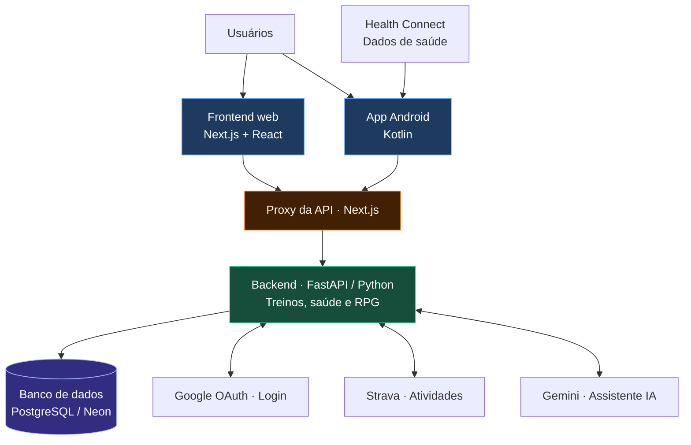

# Murim — Fitness RPG & Saúde

[](https://github.com/DNL-8/Carbon/actions/workflows/ci.yml)

Aplicativo privado de treinos, saúde e evolução de personagem, inspirado no universo Murim. Combina acompanhamento de atividades físicas com progressão de Caçadores (XP) e cultivo (Qi), batalhas, missões e recuperação.

Desenvolvido para duas pessoas, com foco em simplicidade, desempenho, segurança, baixo custo e manutenção. O acesso à aplicação é restrito às identidades Google autorizadas; não há cadastro público.

## Funcionalidades

| Módulo | Recursos |
| --- | --- |
| Treinos | Catálogo, treinos personalizados, séries, cargas, repetições, cronômetro de descanso e histórico. |
| Progressão RPG | XP, Qi, níveis, atributos, batalhas contra chefes, missões, votos e conquistas. |
| Arsenal | 104 equipamentos, dez conjuntos especializados, 15 recompensas de marco, 87 compras, dois itens iniciais, prévia animada e extrato de compras. |
| Saúde | Atividades, passos, sono, frequência cardíaca, calorias, peso, IMC e indicadores de carga e recuperação. |
| Relatórios | Gráficos MUI X Charts de evolução do peso e tendência de atividades, filtros por período e fonte e valores textuais acessíveis. |
| Importação | Apple Health, Samsung Health, GPX e CSV; integração OAuth com Strava. |
| Android | Aplicativo Kotlin para autenticação e sincronização de dados autorizados via Health Connect. |
| Oráculo | Assistente Gemini com consentimento para compartilhamento de resumo de saúde e treino. |

As métricas de recuperação e as sugestões do Oráculo são informativas, não constituem diagnóstico ou recomendação médica individual.

## Arsenal V2

- Quatro slots (26 peças por slot): elmo, armadura, capa e arma. São 51 peças de Caçador, 51 de Murim e dois itens iniciais.
- Resgate gratuito após atingir um marco, inclusive para progresso anterior; compra com moedas e equipar são operações distintas. Os 52 IDs anteriores e os dez IDs de conjuntos foram preservados.
- Bônus especializados em XP, moedas ou dano contra chefes; bônus de conjunto de 2 peças (+4%) ou 4 peças (+10%, substitui o de 2).
- Catálogo com busca sem acentos, filtros, ordenação, 24 peças por página e comparação da prévia com o equipamento ativo.
- Mascote SVG interativo com 33 famílias visuais, miniaturas, animação de golpe e pausa. A coleção completa é opcional; não exige uma rotina específica de treino.

Consulte [Arsenal — catálogo, regras e economia](docs/plano-arsenal.md).

## Stack tecnológica

| Camada | Tecnologia |
| --- | --- |
| Frontend | Next.js (App Router), React, TypeScript |
| Interface | Material UI, Emotion, MUI X Charts Community |
| Estado e formulários | TanStack Query, React Hook Form, Zod |
| API | Python, FastAPI, Pydantic, Uvicorn |
| Autenticação | Authlib, Google OAuth2/OIDC, sessões próprias |
| Banco de dados | PostgreSQL / Neon, SQLAlchemy, psycopg, Alembic |
| Android | Kotlin, Jetpack Compose, Material 3, Health Connect, WorkManager |
| Integrações | Google, Gemini e Strava |
| Qualidade | Ruff, pytest, Playwright, axe-core, JUnit, Gradle, GitHub Actions |
| Dependências | Bun e uv, com lockfiles versionados |

A implementação atual não depende de Vue, Nuxt, Nitro ou Better Auth.

## Arquitetura

Visão geral para quem possui conhecimentos básicos de informática.



- **Frontend:** interface que o usuário acessa pelo navegador.
- **Android:** aplicativo que coleta dados autorizados do Health Connect.
- **Proxy:** encaminha as solicitações dos aplicativos à API.
- **Backend:** valida o acesso e processa treinos, saúde, XP, Qi e equipamentos.
- **Banco de dados:** armazena contas, histórico e progresso.
- **Integrações:** Google para login, Strava para atividades e Gemini para o assistente Oráculo.

O diagrama representa a arquitetura lógica do código, não a confirmação de um ambiente de produção homologado.

## Estrutura do repositório

```text
Carbon/
├── frontend/           # Next.js, componentes, gráficos e testes Playwright
├── backend/            # FastAPI, testes, Alembic e regras de negócio
├── android/            # Kotlin, Health Connect e Gradle wrapper
├── src/                # Tipos e regras RPG compartilhadas
├── scripts/            # Paridade, backup e utilitários
├── docs/               # Documentação técnica e homologação
├── .github/workflows/  # CI e backup PostgreSQL
├── AGENTS.md           # Instruções de desenvolvimento para agentes
├── DESIGN.md           # Identidade visual e acessibilidade
└── README.md
```

## Desenvolvimento local

### Pré-requisitos

- Node.js 24 e Bun 1.4.5.
- Python 3.13 e uv.
- PostgreSQL isolado para desenvolvimento e testes.
- JDK 17 e Android SDK 35 para compilar o aplicativo Android.

Os comandos abaixo usam Windows PowerShell. Execute cada bloco em um terminal separado, a partir da raiz do repositório.

### 1. Backend

```powershell
cd backend
uv sync --locked
if (-not (Test-Path .env)) { Copy-Item .env.example .env }
```

Copie o arquivo de exemplo somente na primeira configuração, sem sobrescrever um `.env` existente. Preencha o banco e a autenticação seguindo o [guia do backend](backend/README.md) e a [configuração Google](docs/python-auth-cutover.md).

Antes de iniciar a aplicação, prepare o banco com Alembic conforme o [guia PostgreSQL / Neon](docs/neon-postgresql.md). Não execute bootstrap de banco vazio contra uma base existente.

```powershell
uv run uvicorn app.main:app --host 127.0.0.1 --port 38202 --no-access-log
```

- API local: http://127.0.0.1:38202
- Swagger: http://127.0.0.1:38202/docs
- Health: `/api/health`; readiness: `/api/ready`.

### 2. Frontend

```powershell
cd frontend
bun install --frozen-lockfile
if (-not (Test-Path .env.local)) { Copy-Item .env.example .env.local }
bun run dev --port 38200
```

Copie o exemplo apenas na primeira configuração. O valor local de `MURIM_FASTAPI_ORIGIN` é `http://127.0.0.1:38202`. Acesse http://127.0.0.1:38200. Consulte o [guia do frontend](frontend/README.md).

### 3. Android

```powershell
cd android
.\gradlew.bat :app:testDebugUnitTest :app:assembleDebug
```

APK: `android/app/build/outputs/apk/debug/app-debug.apk`.

Configure `fitnessApiOrigin` com a origem HTTPS autorizada e registre o pacote e a assinatura do APK no Google Cloud. Para instalação e permissões, consulte o [guia Android](android/README.md).

## Health Connect

A sincronização manual consulta os últimos 30 dias. O WorkManager pode sincronizar periodicamente, aproximadamente a cada seis horas, quando houver conexão e permissão de leitura em segundo plano.

- Coleta de calorias ativas, sem metabolismo basal.
- Medições ausentes não são apresentadas como zeros medidos nos relatórios.
- Importações deduplicadas; atividades corrigidas mantêm o XP original.
- Tokens de alterações criptografados por conta e permissões; o checkpoint avança após confirmação dos lotes.
- Limitações atuais: alterações provocam releitura da janela de 30 dias; exclusões individuais e correções fora da janela ainda não são reconciliadas automaticamente. Calorias antigas podem representar energia total.

## Segurança e privacidade

A autenticação é restrita a identificadores Google previamente vinculados a contas internas distintas. O servidor valida a sessão, a origem das escritas e a propriedade dos registros. Sessões web usam cookies HttpOnly, Secure em HTTPS e SameSite, com tokens armazenados em hash no servidor e expiração de sete dias. O Android mantém o cookie em armazenamento criptografado.

Nunca versione segredos, tokens, IDs de contas autorizadas ou dados pessoais de saúde. Use os arquivos de exemplo e configure credenciais apenas no ambiente privado. Não utilize produção para testes ou bootstrap. O backup PostgreSQL criptografado possui workflow independente, cuja configuração e restauração precisam ser verificadas.

## Testes e qualidade

| Diretório | Verificações |
| --- | --- |
| backend/ | `uv run ruff check .` · `uv run pytest -q` |
| frontend/ | `bun run lint` · `bun run typecheck` · `bun run build` · `bun run test` |
| android/ | `.\gradlew.bat :app:testDebugUnitTest :app:assembleDebug` |

Quando o contrato OpenAPI mudar, execute `bun run generate:api` em `frontend/`. Os testes de integração exigem PostgreSQL descartável em loopback, banco `murim_fastapi_test` e dados sintéticos. Consulte [CI](docs/ci.md).

O pipeline principal possui dois jobs: Aplicação (FastAPI + Next.js) e Android (testes e APK). Inclui auditoria de dependências, paridade RPG, migrations, contratos, testes de integração e acessibilidade desktop/mobile.

## Estado e homologação

- Arsenal V2 publicado na main no commit [cbee77b](https://github.com/DNL-8/Carbon/commit/cbee77bf5ea24532ccc445bcd68c76aee034e60e). Estado consultado em 28/11/2026: [execução 46104328684](https://github.com/DNL-8/Carbon/actions/runs/46104328684), homologação automatizada ainda não concluída na consulta. Acompanhe o [pipeline atual](https://github.com/DNL-8/Carbon/actions); esta anotação é histórica.
- Referência anterior: [commit 44c093c](https://github.com/DNL-8/Carbon/actions/runs/46039846414), aprovado nos dois jobs antes da expansão.
- Google, Gemini e Strava são simulados nos testes automatizados.
- Homologação com provedores reais, Health Connect em aparelho físico, restauração de backup e compatibilidade do banco de destino ainda precisam ser confirmadas.
- Não há confirmação de que um deployment de produção executa esta versão da stack. Valide o commit e o ambiente antes de utilizar o aplicativo com dados reais.

## Documentação

| Documento | Conteúdo |
| --- | --- |
| [AGENTS.md](AGENTS.md) | Arquitetura, regras de trabalho, segurança e Codex |
| [DESIGN.md](DESIGN.md) | Identidade visual, tipografia, componentes e acessibilidade |
| [Frontend](frontend/README.md) | Execução web e contratos |
| [Backend](backend/README.md) | API, banco e testes |
| [Android](android/README.md) | APK, autenticação e Health Connect |
| [Autenticação Google](docs/python-auth-cutover.md) | Configuração privada das contas |
| [PostgreSQL / Neon](docs/neon-postgresql.md) | Compatibilidade, Alembic e backup |
| [CI](docs/ci.md) | Pipeline de validação |
| [Homologação](docs/homologacao.md) | Roteiro de aceite e testes reais |
| [Arsenal V2](docs/plano-arsenal.md) | Catálogo, regras, arte, API e simulação econômica |
| [Auditoria](docs/auditoria.md) | Alterações e limitações conhecidas |
| [Migração legada](docs/migracao-legado.md) | Pré-voo e preservação de dados |
